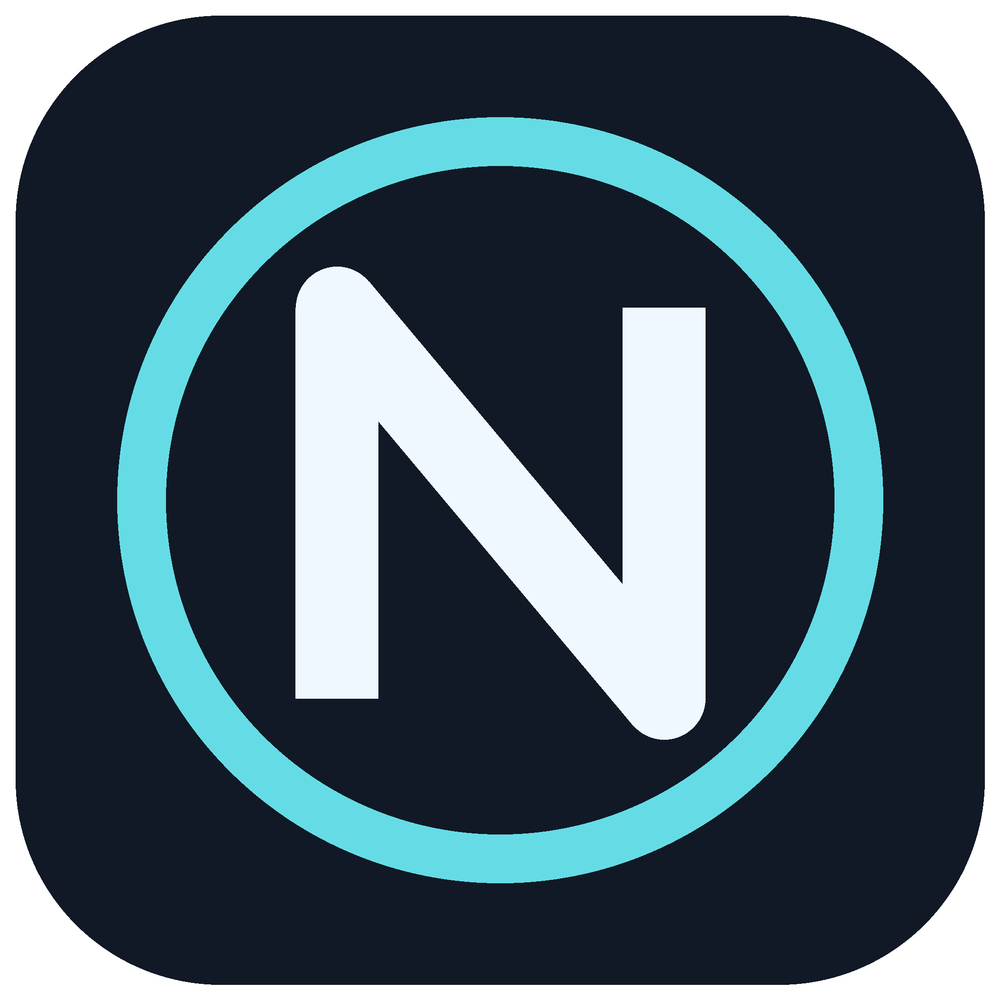
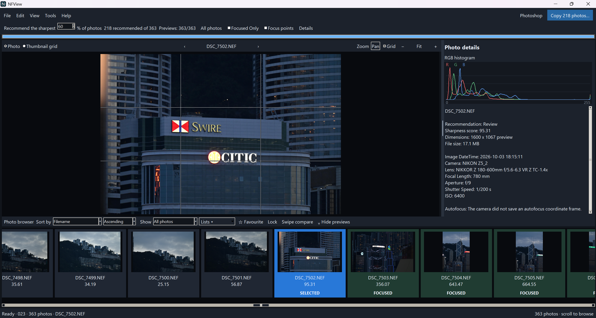
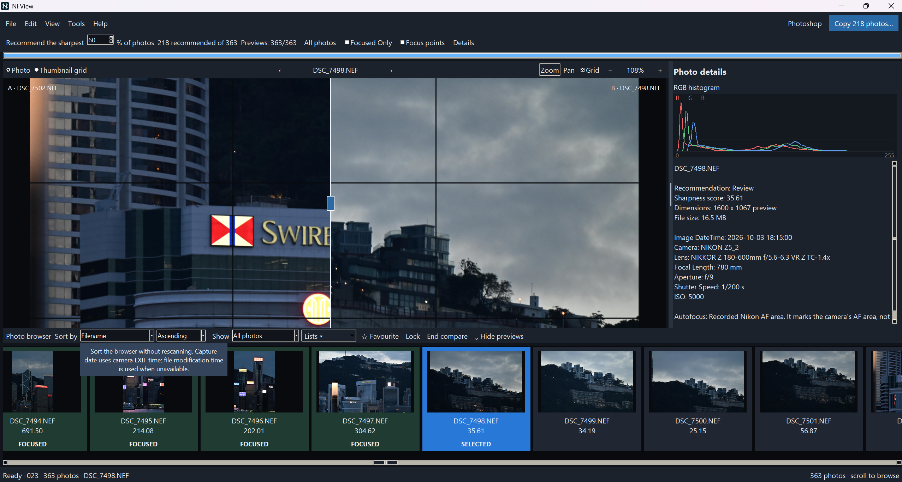

# NFView

NFView makes Nikon RAW (NEF) files easier and faster to view on Windows. Browse the camera’s embedded previews, zoom in to inspect a photo, and compare shots without opening a full RAW editor. Cached previews make repeat browsing and sorting quick.

Review sharpness recommendations, organise favourites and custom lists, and compare photos with a swipe divider. NFView is a preview and photo review tool; it does not develop RAW files.



## Screenshots

### Nikon RAW viewer

Browse NEF photos with a filmstrip, RGB histogram, camera details and optional grid lines.



### Swipe comparison

Pin a reference photo and drag the divider to compare it with another shot.



## Run the Windows beta

Download and extract the Windows beta ZIP from [GitHub Releases](https://github.com/harrymings/NFView/releases), then double-click `NFView.exe`. No Python installation is required. On first launch, choose a photo folder. Use **Help → User guide** for the tabbed manual.

## Run from source

Tested with Python 3.11 on Windows. Tkinter must be available.

```powershell
py -m pip install -r requirements.txt
py -m nfview
```

If your Python launcher is unavailable, replace `py` with `python`.

## Review workflow

1. Open a photo folder. Subfolders are included.
2. Choose a recommendation percentage and inspect the photos. **All photos** clears recommendation and list filters. Sorting and layout changes reuse previews.
3. **Copy photos** creates a new folder containing recommended originals. It does not copy only the displayed list or favourites.

Use **Zoom / Pan** to choose the left-drag tool. Default controls: drag down/up to zoom; wheel zooms toward the pointer; double-click zooms to 50%; middle/right-drag pans; a right-click without dragging fits the photo. **Edit → Settings** customises mouse controls and the application used to open originals. Photoshop is the default.

**Swipe compare (C)** pins photo A and opens B. Drag the centre divider. The small reference preview can be hidden; double-click it to centre the divider.

Favourites, locks and custom lists are saved per folder. A lock protects favourite status and list memberships; unlock before editing or deleting. **Delete** moves the selected original to the Recycle Bin after confirmation. There is no permanent-delete fallback. Windows Recycle Bin can restore the file, but removed list memberships must be added again.

Drag the divider beside Photo details to resize it. The filmstrip can be hidden. The RGB histogram, rule-of-thirds grid and recorded Nikon focus points are viewing aids.

## Scoring and limitations

Sharpness uses variance of the Laplacian in the existing centre region. Texture and noise can raise scores; compare similar photos. Stacking suitability uses ORB matching and a RANSAC homography. It is not a guarantee of perfect focus or alignment.

RAW preview resolution is determined by the embedded camera preview. Zooming does not reveal full RAW sensor detail. Some files have black or unusable embedded previews. Recorded autofocus overlays depend on camera metadata and may be approximate or unavailable. No AI, face detection or extra scoring modes are used.

## Cache and settings

Version-3 `.image-screener-cache.json` reuses scores for unchanged files. Thumbnail previews, capture dates, settings and review choices are stored in hidden `.image-screener-*` files alongside the photo folder. Do not upload these files or your photos to the source repository. Keep `.image-screener-review.json` when moving a folder to retain favourites and lists.

Rescan checks changed files; full reanalysis is available in Tools. Cancel stops after the current photo finishes.

## Command-line options

```powershell
py -m nfview "C:\Photos" --keep-percent 60
py -m nfview "C:\Photos" --mode stacking --reference "C:\Photos\reference.NEF"
py -m nfview "C:\Photos" --keep-percent 60 --copy-to "C:\Picks"
```

The existing `--stack-to` option can save an aligned median stack. The preview browser also offers stack creation and optional CSV/HTML reports.

## Build the executable

```powershell
py -m pip install -r requirements-build.txt
py -m PyInstaller --noconfirm NFView.spec
```

The one-file, windowed executable is written to `dist/NFView.exe`. The logo is embedded; it needs no external icon file at runtime.

Folder drag-and-drop is optional for source users: install `tkinterdnd2` if desired. The beta does not require it.

## Help and feedback

See [REVIEW_GUIDE.md](REVIEW_GUIDE.md), or open **Help → User guide** in the app. For beta issues, include the Windows version, display scaling, file type and steps to reproduce. Avoid uploading private photos or review settings.

GitHub: [harrymings](https://github.com/harrymings).

## License

NFView is released under the [MIT License](LICENSE). Bundled dependencies retain their respective licenses; see [THIRD_PARTY.md](THIRD_PARTY.md).

## Project structure

- `nfview/`: image loading, Nikon metadata, scoring, scan cache, exports, stacking and command-line entry point.
- `nfview/ui/`: viewer, mouse tools, browser, collections, dialogs, panel layout and scan lifecycle.
- `assets/`: app branding and screenshots.
- `image_screener.py`: small compatibility launcher.
- `NFView.spec` and `build.cmd`: Windows executable build.

